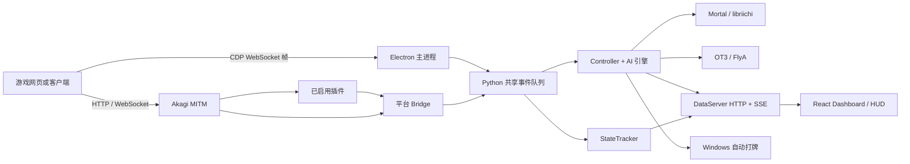
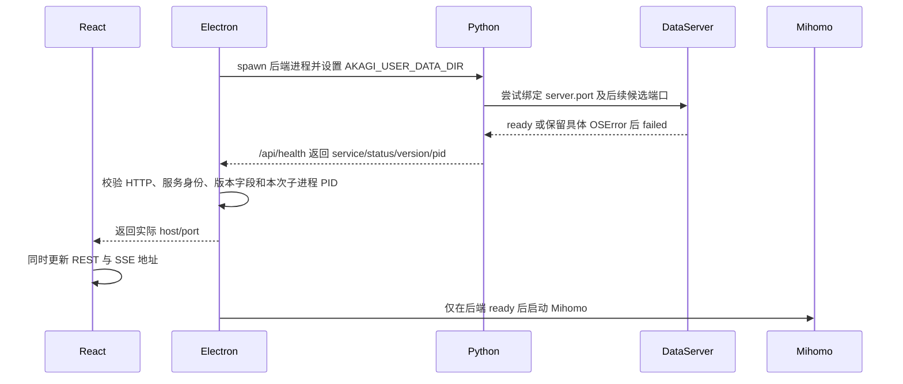

# Akagi-NG 项目维护、排障、开发与灾难恢复手册

> 适用对象：第一次接手项目的维护者、需要按步骤执行任务的 AI、临时救火人员。  
> 当前基线：Akagi-NG `1.2.4`；插件仓库 Release `v1.0.1`；雀魂 MAX `v2026.07.07`；一番街本地解锁 `v0.1.8`。  
> 基线日期：2026-08-11。版本会变化，开始工作前必须按本文重新核对。  
> 主仓库：`F:\akagi\Akagi-NG-publish`。  
> 插件仓库：`F:\akagi\Akagi-NG-Plugins`。

这不是一篇产品宣传，也不是“遇到报错就重装”的 FAQ。它是项目的接手说明书、日常操作规程、故障手册、开发指南、发布清单和灾难恢复计划。即使维护者不了解 Python、React、Electron、代理、麻将协议或 Git，也应当先按这里的顺序收集证据，再决定是否修改代码。

如果本文与代码冲突，以同一提交中的代码、测试和配置 schema 为准；确认代码行为后，应立即同步修正文档，不能让错误说明继续流传。

---

## 0. 十条不可违反的规则

1. **先执行 `git status`，再碰任何文件。** 工作树中的改动可能属于别人。禁止为了“恢复干净”而执行 `git reset --hard`、批量覆盖或删除不认识的文件。
2. **先备份用户数据，再处理配置、插件和代理。** 代码可以重新拉取；`<userData>` 中的密钥、插件设置和诊断日志不一定能恢复。
3. **日志是证据，不是垃圾。** 报错时间、版本、平台、首次异常和前后事件必须保留。最后一条报错通常只是上游错误的后果。
4. **只修改源文件，不手改生成物。** 不要直接修改 `dist/`、`build/`、`output/`、解压后的 Release、`app.asar` 或打包 Python 中的文件来冒充永久修复。
5. **不要向发行包的 Python 执行随意的 `pip install`。** 一番街插件不需要 PyYAML；项目统一使用已打包的 `ruamel.yaml`。临时安装依赖会让本机“看似修好”，但其他用户仍会失败。
6. **每次修改必须有回归测试。** 至少证明“修复前能复现、修复后通过、邻接功能没坏”。没有验证的代码不算完成。
7. **版本号不能混用。** NG 桌面版本、插件仓库 Release 标签、单个插件版本是三套独立标识，详见第 2 章。
8. **代理、MITM、自动打牌和插件都属于高风险边界。** 默认关闭；改动要有开关、超时、取消、失败关闭和清晰日志，不能静默改变用户网络或输入。
9. **密钥、完整流量、用户身份和牌谱不能进入 Git、Issue 或公开日志。** 分享前必须脱敏。
10. **无法证明时写“尚未确定”，不要猜。** 同时写清缺少什么证据、下一条检查命令和备用路径。

### 0.1 一次修改何时才算完成

必须同时满足：

- 问题或需求有清晰定义，影响范围已列出；
- 找到真正的数据流和责任模块，而不是只改表面提示；
- 最小修复已实现，异常路径和取消路径已考虑；
- 新增或更新测试，相关测试、静态检查和构建通过；
- 用户数据、旧配置和旧插件的兼容性已验证；
- `CHANGELOG.md`、Release Notes、README 或本手册按需更新；
- `git diff` 中没有密钥、日志、模型、构建产物和无关格式化；
- 有明确回滚方法；
- Release 包做过独立于源码环境的冒烟测试。

---

## 1. 快速接手：前 30 分钟应该做什么

在 PowerShell 中执行：

```powershell
$NgRepo = 'F:\akagi\Akagi-NG-publish'
$PluginRepo = 'F:\akagi\Akagi-NG-Plugins'

git -C $NgRepo status --short --branch
git -C $NgRepo log -5 --oneline --decorate
git -C $NgRepo remote -v

git -C $PluginRepo status --short --branch
git -C $PluginRepo log -5 --oneline --decorate
git -C $PluginRepo remote -v

node --version
npm --version
python --version
```

预期开发基线：

- Node.js `>=24`；
- Python `>=3.12`，项目当前构建便携 Python `3.12.13`；
- npm 使用根目录锁文件执行 `npm ci`；
- 主仓库根 `package.json`、后端 `pyproject.toml`、前端和 Electron 的 `package.json` 版本一致；
- 两个仓库都没有不明改动后，才允许切分支、同步远端或发布。

然后记录一份接手快照：

```powershell
git -C $NgRepo status --porcelain=v1 | Out-String
git -C $NgRepo rev-parse HEAD
git -C $NgRepo describe --tags --always --dirty
git -C $PluginRepo rev-parse HEAD
git -C $PluginRepo describe --tags --always --dirty
```

### 1.1 本文编写时的特别状态

本文创建时，主仓库工作树包含尚未提交的后端启动握手修复：DataServer 启动成功/失败事件、端口绑定详细错误、专用 `/api/health`、Electron 真实错误透传、实际回退端口同步和相关测试。**接手者不得假定这些改动已经提交，也不得用 reset 清除。** 必须以 `git status` 和 `git diff` 为准，完整验证后再决定提交或继续修改。

`output/` 中可能存在隔离启动探针生成的临时文件。它不是产品源码，不应提交；也不要因为全量 Prettier 扫到它就格式化或覆盖用户数据。先确认路径和用途，再按项目约定清理或加入忽略规则。

---

## 2. 三套版本体系：最容易犯错的地方

| 层级             | 示例                               | 保存位置                                         | 何时更新                                 | 不更新会怎样                                   |
| ---------------- | ---------------------------------- | ------------------------------------------------ | ---------------------------------------- | ---------------------------------------------- |
| NG 桌面程序      | `1.2.4` / Git 标签 `v1.2.4`        | 根 `package.json`，同步到后端、前端、Electron    | 主程序源码或发行包发生用户可见变化       | 包内版本、更新器、Release 和 Python 版本不一致 |
| 插件仓库 Release | `v1.0.1`                           | 插件仓库 Git 标签和每个 `download_url`           | 重新发布一组 `index.json` 与插件 ZIP     | 下载地址仍指向旧 Release 或资产不存在          |
| 单个插件版本     | MAX `v2026.07.07`；一番街 `v0.1.8` | 插件的 `akagi-plugin.json` 与 `plugin.py` 元数据 | 该插件目录内的运行时代码、数据或行为变化 | 质量门拒绝，客户端无法正确判断更新             |

必须记住：

- 发布 NG `1.2.5` 不代表必须把 MAX 或一番街插件升版；如果只是更新插件兼容测试基线，可不改插件版本。
- 更新一番街插件 `v0.1.9` 不代表 NG 必须发 `1.2.5`；插件可独立发布。
- 插件仓库 Release 可以从 `v1.0.1` 升到 `v1.0.2`，其中两个 ZIP 的单插件版本可以只升发生变化的那个。
- 插件 ID 是持久身份，升级时绝对不能把 `majsoul-max` 或 `riichicity-local-unlock` 改成新 ID。
- 当前 NG 管理器用“版本字符串不相等”标记更新，并非完整语义版本比较。因此目录只能向前发布，不能把旧版本重新写进 `index.json`，否则降级也会显示为“更新”。

### 2.1 NG 版本同步标准流程

只修改根 `package.json` 的版本，然后执行：

```powershell
Set-Location F:\akagi\Akagi-NG-publish
npm run sync-version
git diff -- package.json package-lock.json akagi_backend/pyproject.toml akagi_frontend/package.json electron/package.json
```

同步脚本应更新：

- 根 `package.json`；
- 根 `package-lock.json` 及 workspace 条目；
- `akagi_backend/pyproject.toml`；
- `akagi_frontend/package.json`；
- `electron/package.json`。

构建生成的 `akagi_ng/_version.py` 不是手工维护文件，不应作为源文件随意提交。

---

## 3. 项目到底是什么

Akagi-NG 是一个 Electron 桌面应用。它把多个技术栈组合在一起：

- Electron 主进程负责窗口、托盘、游戏内置浏览器、进程生命周期、更新器、Mihomo 和安全边界；
- React 前端负责 Dashboard、HUD、设置、日志、插件和自动化界面；
- Python 后端负责配置、平台协议解析、状态追踪、AI 推理、MITM、插件、自动打牌和 HTTP/SSE 服务；
- 平台 Bridge 把雀魂、天凤、一番街、天月等平台消息转换成统一 MJAI 事件；
- 本地 Mortal/libriichi 或在线 OT3/FlyA 根据 MJAI 历史给出决策；
- DataServer 通过 HTTP 提供管理 API，通过 SSE 推送状态与推荐；
- 插件在同一个 mitmproxy 流程中修改经过授权的 HTTP/WebSocket 流量。

### 3.1 高层架构



这张图说明一个重要原则：出现“没有推荐”时，不能直接认定模型坏了。故障可能发生在游戏帧未捕获、Bridge 未解析、事件队列、Controller、模型加载、在线 API、DataServer、SSE 或前端渲染中的任何一层。

### 3.2 正常启动顺序



正确语义是“spawn 成功不等于后端 ready”。DataServer 绑定失败必须快速让 Python 非零退出，并把端口、`errno`、`winerror` 和原始异常传到界面；不能让一个没有 HTTP 服务的 Python 主循环假运行 20 秒。

### 3.3 运行时关键不变量

修改代码时必须保护以下条件：

- Python 主事件队列有界，不能因网络请求或插件阻塞而无限增长；
- 同一平台消息只转换一次，MJAI 历史顺序不能被排序、并发或重试改写；
- 在线模型失败必须可回退本地模型，且有状态会话不能在动作分叉后继续复用；
- DataServer 对外公布的端口必须是实际监听端口；React REST、SSE、Electron shutdown 和游戏帧转发必须使用同一个实际端点；
- 只有本次 Electron 启动的 Python PID 才能通过健康检查，不能把旧孤儿进程误认成新后端；
- 插件异常要被隔离，不能让主 Bridge 线程退出；
- 自动打牌只能操作明确匹配的窗口，并且用户关闭功能、开始匹配、退出对局或失去状态时可立即取消；
- 服务端真实库存、账号权益和付费数据不能被插件本地状态覆盖或伪装成可提交的服务端事实；
- 日志失败不能反过来让业务进程崩溃；
- 任何密钥都不能通过公共 settings API 原样返回。

---

## 4. 仓库地图

### 4.1 主仓库

```text
Akagi-NG-publish/
├─ akagi_backend/
│  ├─ akagi_ng/
│  │  ├─ __main__.py             # Python CLI 入口
│  │  ├─ application.py          # 组件装配、主事件循环、清理
│  │  ├─ core/                   # AppContext、路径、日志等基础设施
│  │  ├─ settings/               # 配置 dataclass、读写、schema、密钥
│  │  ├─ dataserver/             # aiohttp REST、SSE、生命周期
│  │  ├─ bridge/                 # 各游戏平台 -> MJAI
│  │  ├─ mitm_client/            # mitmproxy addon 与流量入口
│  │  ├─ electron_client/        # CDP/内置浏览器消息入口
│  │  ├─ mjai_bot/               # Controller、Tracker、引擎、OT3、FlyA
│  │  ├─ autoplay/               # 规划、延迟、Windows 输入、自动加入
│  │  └─ plugins/                # 插件 API、管理器、安装器、安全校验
│  ├─ tests/                     # Python 单元/集成测试
│  ├─ scripts/build_backend.py   # 便携 Python 后端构建
│  └─ pyproject.toml
├─ akagi_frontend/
│  └─ src/
│     ├─ pages/                  # Dashboard、HUD 页面
│     ├─ components/             # 设置、日志、插件、自动化等组件
│     ├─ contexts/               # REST/SSE、游戏、主题上下文
│     ├─ hooks/                  # 复用状态逻辑
│     ├─ lib/                    # API 客户端、类型、工具
│     ├─ i18n/locales/           # zh-CN、zh-TW、en-US、ja-JP
│     └─ index.css               # Tailwind 与全局样式
├─ electron/src/
│  ├─ main.ts                    # 桌面主入口和启动编排
│  ├─ backend-manager.ts         # Python spawn、health、shutdown
│  ├─ preload.ts                 # renderer 唯一受控 IPC 桥
│  ├─ ipc-handlers.ts            # IPC 参数验证和处理
│  ├─ security-policy.ts         # URL、窗口角色、IPC allowlist
│  ├─ window-manager.ts          # Dashboard、游戏、HUD、托盘
│  ├─ game-handler.ts            # CDP 游戏帧转发
│  ├─ mihomo-manager.ts          # Mihomo 生命周期
│  └─ updater.ts                 # GitHub Release 更新
├─ assets/
│  ├─ settings.default.json      # 配置默认值
│  ├─ settings.schema.json       # 配置 JSON Schema
│  └─ liqi.json                  # 雀魂协议定义默认资产
├─ lib/                          # libriichi 平台二进制
├─ models/                       # Mortal 模型
├─ scripts/                      # 构建、版本同步、回归测试工具
├─ docs/                         # 协议、插件、发布说明、本手册
├─ .github/workflows/            # test、build、release
├─ package.json                  # 根脚本和唯一手工版本入口
└─ package-lock.json             # npm 可复现依赖锁
```

### 4.2 插件仓库

```text
Akagi-NG-Plugins/
├─ plugins/
│  ├─ majsoul-max/
│  │  ├─ akagi-plugin.json
│  │  ├─ plugin.py
│  │  ├─ assets/max_data.yaml
│  │  └─ majsoul_max_vendor/
│  └─ riichicity-local-unlock/
│     ├─ akagi-plugin.json
│     ├─ plugin.py
│     ├─ riichicity_config.py
│     ├─ riichicity_unlock_proxy.py
│     ├─ riichicity_mitm/
│     └─ config/*.example.*
├─ scripts/
│  ├─ build_packages.py          # 确定性构建 ZIP、生成 hash/index
│  └─ check_version_changes.py   # 改动插件必须严格升版
├─ tests/
│  ├─ test_packages.py           # 包结构、安全、hash、index
│  └─ test_runtime.py            # 真实 NG API 的隔离运行测试
├─ index.json                    # 远程目录；客户端实际读取
└─ .github/workflows/
   ├─ quality.yml
   └─ release.yml
```

---

## 5. 用户数据、配置和敏感信息

### 5.1 `<userData>` 是什么

正式 Electron 包启动 Python 时会设置绝对路径环境变量 `AKAGI_USER_DATA_DIR`。Windows 当前通常为：

```text
C:\Users\<用户名>\AppData\Roaming\akagi-ng-desktop
```

不要把这个示例硬编码进程序。应以 Electron 的 `app.getPath('userData')` 或日志中的实际路径为准。源码模式未设置该变量时，Python 会回退到项目根目录；这就是为什么测试必须使用临时 `AKAGI_USER_DATA_DIR`，否则可能污染真实配置。

### 5.2 目录含义

```text
<userData>/
├─ config/
│  ├─ settings.json
│  ├─ settings.json.bak
│  ├─ secrets.json
│  ├─ liqi.json                  # 可选用户协议覆盖
│  ├─ plugins.json               # 插件启用状态
│  └─ plugins/
│     ├─ majsoul-max/settings.yaml
│     └─ riichicity-local-unlock/
│        ├─ settings.yaml
│        ├─ unlock_state.json
│        ├─ user_settings.json
│        └─ logs/
├─ logs/
│  ├─ akagi_*.log
│  └─ electron_*.log
└─ plugins/
   ├─ majsoul-max/               # 安装后的代码
   └─ riichicity-local-unlock/
```

插件代码与配置分离，所以远程原子更新代码时，`config/plugins/<id>` 下的用户选择不会被覆盖。

### 5.3 配置规则

- 默认值在 `assets/settings.default.json`；
- 合法范围在 `assets/settings.schema.json`；
- Python 类型和迁移在 `akagi_backend/akagi_ng/settings/settings.py`；
- 无效 `settings.json` 会备份为 `settings.json.bak` 并恢复默认；
- server、MITM、Mihomo 端口必须在 `1024..65535` 且互不重复；
- 默认后端 `127.0.0.1:8765`、MITM `6789`、Mihomo mixed `7890`、controller `9090`；
- API Key 等秘密由后端密钥存储处理，公共 settings 只能返回“是否已配置”和末尾提示，不能返回明文；
- `config/liqi.json` 存在时覆盖内置 `assets/liqi.json`。协议问题排查时必须确认实际加载的是哪个文件。

---

## 6. 开发环境从零建立

以下命令假定 Windows PowerShell，路径含空格时始终用引号。

### 6.1 安装依赖

```powershell
Set-Location F:\akagi\Akagi-NG-publish

# 查看版本
node --version
npm --version
python --version
git --version

# 后端虚拟环境
Set-Location .\akagi_backend
python -m venv .venv
& .\.venv\Scripts\Activate.ps1
python -m pip install --upgrade pip
python -m pip install -e '.[dev]'
Set-Location ..

# 前端与 Electron；严格使用锁文件
npm ci
```

准备本平台的 `libriichi`：

```powershell
Copy-Item .\lib\libriichi-3.12-x86_64-pc-windows-msvc.pyd .\lib\libriichi.pyd
Copy-Item .\lib\libriichi3p-3.12-x86_64-pc-windows-msvc.pyd .\lib\libriichi3p.pyd
```

ARM64、Linux、macOS 必须选择匹配 Python ABI、CPU 和操作系统的二进制，不能把 Windows `.pyd` 改后缀冒充 `.so`。

### 6.2 开发运行

```powershell
Set-Location F:\akagi\Akagi-NG-publish
npm run dev
```

它会同时启动 Vite 前端和 Electron。Electron 开发模式再拉起 Python 后端。若只开发界面、不想连接真实游戏，可用：

```powershell
npm run dev:mock
```

### 6.3 单独运行后端

为了避免写入真实用户数据，使用新的绝对临时目录：

```powershell
$env:AKAGI_USER_DATA_DIR = 'F:\akagi\tmp\akagi-ng-dev-userdata'
$env:PYTHONUTF8 = '1'
Set-Location F:\akagi\Akagi-NG-publish\akagi_backend
& .\.venv\Scripts\python.exe -m akagi_ng
```

结束后移除当前 shell 的测试变量：

```powershell
Remove-Item Env:AKAGI_USER_DATA_DIR -ErrorAction SilentlyContinue
Remove-Item Env:PYTHONUTF8 -ErrorAction SilentlyContinue
```

切勿把 `$HOME`、`$env:APPDATA` 或真实 `<userData>` 重定向为测试目录。

### 6.4 健康检查

```powershell
Invoke-RestMethod http://127.0.0.1:8765/api/health | ConvertTo-Json -Depth 5
```

正确返回结构：

```json
{
  "ok": true,
  "data": {
    "service": "akagi-ng",
    "status": "ready",
    "version": "1.2.4",
    "pid": 12345
  }
}
```

源码未生成 `_version.py` 时版本可能显示 `dev`；只要求非空且与运行形态一致。Electron 还会校验 `pid` 必须等于本次启动的 Python 子进程，防止旧进程伪装成新后端。

### 6.5 生产构建

```powershell
Set-Location F:\akagi\Akagi-NG-publish
npm ci
npm run build
```

构建流程会：清理允许清理的生成物、同步版本、构建 React、下载/整理便携 Python、安装后端依赖、编译 Electron、准备资源清单并用 electron-builder 打包。产物位于 `dist/release`。

后端构建会访问网络下载固定 Python 发行物和 Python 依赖；离线环境必须预先准备缓存。不要在构建中途用其他 Python 进程修改同一个 `dist/backend`。

---

## 7. 日常维护标准流程

### 7.1 开始任务

1. 把用户原始需求原样写入 Issue、任务记录或本地笔记。
2. 记录两仓库 HEAD、分支、状态、版本和本机环境。
3. 判断任务属于后端、Bridge、模型、Electron、UI、插件、构建还是多层联动。
4. 先阅读入口和现有测试，禁止凭文件名猜行为。
5. 如果是故障，先做最小复现并保存修复前证据。
6. 创建专用分支；不要在 Release 标签或不明脏工作树上直接开发。

### 7.2 修改中

- 一次提交只解决一个逻辑主题；
- 新增日志要包含动作、状态和安全标识，但不包含密钥和完整私人数据；
- 网络调用必须有连接超时、读取超时、总 deadline、取消和失败语义；
- 写文件优先临时文件 + 原子替换；
- 后台线程必须有终止事件和 join 超时；
- 捕获异常时保留 `raise ... from exc`，不要只写“发生错误”；
- 不要用宽泛 `except Exception: pass` 掩盖失败；
- 不要让测试依赖开发机碰巧安装的包、真实 AppData、真实账号或当前时区。

### 7.3 提交前

```powershell
Set-Location F:\akagi\Akagi-NG-publish

git diff --check
git diff --stat
git diff

& .\akagi_backend\.venv\Scripts\python.exe -m ruff check .\akagi_backend\akagi_ng .\akagi_backend\tests
& .\akagi_backend\.venv\Scripts\python.exe -m ruff format --check .\akagi_backend\akagi_ng .\akagi_backend\tests

npm run typecheck
npm run lint
npx prettier --check <本次修改的前端、Electron和Markdown文件>
```

全量 `npm run format` 会扫描仓库内未忽略的临时 JSON；如果失败，先分辨是源码格式问题还是 `output/` 等未跟踪探针数据，不能为了绿灯去格式化用户数据。

### 7.4 交付时必须说明

- 修改了什么；
- 根因是什么，证据在哪里；
- 执行了哪些测试及结果；
- 哪些测试因环境原因没跑；
- 配置是否迁移、是否需要重启；
- 已知风险；
- 如何回滚；
- 是否已提交、推送、打标签或发布。不要把这些动作含糊成“已更新”。

---

## 8. 备份、恢复与灾难预案

### 8.1 备份目标

建议目标：

- 代码恢复点目标（RPO）：每个可验证变更都提交并推送，最多丢失一个正在开发的任务；
- 用户配置 RPO：任何设置迁移、插件更新和大版本升级前立即备份，平时至少每日一次；
- 代码恢复时间目标（RTO）：2 小时内从 Git + 构建说明恢复开发环境；
- 用户环境 RTO：4 小时内安装上一稳定包并恢复非秘密配置；
- 每季度做一次真实恢复演练。没有恢复演练的备份只能算“可能存在的文件”。

采用 3-2-1：至少 3 份副本、2 种介质、1 份不在当前电脑。GitHub 不是用户数据备份；本机另一个文件夹也不算异地备份。

### 8.2 需要备份什么

| 对象         | 必须备份                                             | 不应备份或需单独处理                                                             |
| ------------ | ---------------------------------------------------- | -------------------------------------------------------------------------------- |
| 主仓库       | Git 提交、标签、Release Notes、锁文件                | `node_modules`、`.venv`、`dist` 可重建                                           |
| 插件仓库     | Git 提交、标签、`index.json`、Release 资产与 SHA-256 | `dist` 可由固定提交重建，但发布资产最好留存                                      |
| 用户设置     | `config/settings.json`、`liqi.json`、`plugins.json`  | 分享给别人前删除账号、URL、路径等敏感内容                                        |
| 插件设置     | `config/plugins/` 全部                               | 一番街 `logs/bodies` 可能含敏感响应，需加密保存                                  |
| 密钥         | 记录“有哪些 key 需要重新配置”                        | Windows `secrets.json` 使用 DPAPI，跨机器/用户通常不能直接解密；不要公开备份明文 |
| 模型和二进制 | 文件名、来源、版本、SHA-256；稀缺文件可离线保存      | 不要无来源地把大模型提交 Git                                                     |
| 日志         | 故障前后完整时间段、版本信息                         | 公开前脱敏；常规日志默认轮转，不是永久审计库                                     |

### 8.3 用户数据安全备份示例

先完全退出 NG，确认没有 `akagi-ng`、Electron 或 Mihomo 进程继续写文件。下面示例把秘密文件和可能含响应正文的一番街 body 目录排除在普通支持包外：

```powershell
$UserData = Join-Path $env:APPDATA 'akagi-ng-desktop'
$Stamp = Get-Date -Format 'yyyyMMdd-HHmmss'
$BackupRoot = Join-Path 'D:\Akagi-Backups' "userdata-$Stamp"

New-Item -ItemType Directory -Path $BackupRoot | Out-Null
Copy-Item (Join-Path $UserData 'config\settings.json') $BackupRoot -ErrorAction SilentlyContinue
Copy-Item (Join-Path $UserData 'config\liqi.json') $BackupRoot -ErrorAction SilentlyContinue
Copy-Item (Join-Path $UserData 'config\plugins.json') $BackupRoot -ErrorAction SilentlyContinue
Copy-Item (Join-Path $UserData 'config\plugins') $BackupRoot -Recurse -ErrorAction SilentlyContinue
Copy-Item (Join-Path $UserData 'logs') $BackupRoot -Recurse -ErrorAction SilentlyContinue
```

随后人工检查并移除：

- `secrets.json`；
- API Key、token、cookie、UID、昵称；
- 一番街 `logs/bodies/`；
- 完整 WebSocket/HTTP 内容；
- 不希望公开的本机路径和代理凭据。

如果备份只供同一 Windows 账户本机恢复，可以把 `secrets.json` 放入单独加密归档；仍应准备重新输入密钥的备用方案，因为 DPAPI 文件复制到另一台机器通常不可用。

### 8.4 代码备份和可重建性

每次正式发布后保存：

```powershell
git -C F:\akagi\Akagi-NG-publish bundle create D:\Akagi-Backups\Akagi-NG-v1.2.4.bundle --all
git -C F:\akagi\Akagi-NG-Plugins bundle create D:\Akagi-Backups\Akagi-NG-Plugins-v1.0.1.bundle --all
```

同时下载 GitHub Release 的所有资产，并生成校验：

```powershell
Get-FileHash D:\Akagi-Backups\release-assets\* -Algorithm SHA256
```

至少保存：

- 源代码 Git bundle；
- `package-lock.json`；
- Python 固定版本和构建脚本中便携 Python URL；
- 各平台 `libriichi`；
- 默认模型及 SHA-256；
- NG Release 包；
- 插件 Release 的两个 ZIP、`index.json` 和 SHA-256；
- 本手册。

### 8.5 恢复演练

在全新临时目录而非当前工作树中：

1. 从 Git bundle 或远端 clone 指定 tag；
2. 执行 `npm ci`；
3. 新建 Python 3.12 venv 并安装 `.[dev]`；
4. 准备 `libriichi` 与模型；
5. 运行质量门；
6. 构建生产包；
7. 使用新的临时 `<userData>` 启动；
8. 检查 `/api/health`、Dashboard、SSE、设置读写；
9. 安装两个插件但一次只启用一个，执行运行时测试；
10. 关闭并确认无残留进程、端口和临时路由。

如果只有在原工作树、原 venv 或开发机全局 site-packages 中才能通过，说明恢复计划失败。

### 8.6 紧急回滚

发生线上事故时，优先恢复服务，不要在用户机器上即兴改源码：

1. 停止分发新 Release 或从插件目录撤下有问题的版本；
2. 保存当前日志、设置、插件目录和版本证据；
3. 回滚到上一份已验证 Release 包；
4. 保留当前 `<userData>` 的只读副本；
5. 如怀疑配置迁移，使用复制出来的配置验证，不直接覆盖原件；
6. 插件问题先禁用插件，不要删除其配置；
7. 记录受影响版本、首次发生时间、范围和临时措施；
8. 在分支上补测试和永久修复；
9. 发布修订版本，不移动已存在的 Git 标签，也不替换同名 Release 资产。

---

## 9. 通用故障分析方法

### 9.1 先建立时间线

每次故障至少收集：

- 用户看到的完整错误文本和截图；
- 发生的本地日期、时间、时区；
- NG 桌面版本、插件仓库 Release、单插件版本；
- Windows 版本、CPU 架构、是否管理员；
- 使用内置浏览器、外部浏览器、MITM 还是 Mihomo TUN；
- 平台、四麻/三麻、模型、在线服务；
- 故障前最后一个成功动作；
- 最新 `electron_*.log` 与同时间的 `akagi_*.log`；
- 是否可稳定复现；
- 最近改过什么设置、插件、代理或杀毒软件。

读日志按时间而不是按文件名猜：Electron 日志记录桌面生命周期，Akagi 日志记录 Python 业务。把两者按时间对齐，寻找**第一条异常**，再区分后续连锁错误。

### 9.2 故障分层

```text
L0 操作系统：权限、端口、文件、证书、驱动、安全软件
L1 Electron：进程、资源、窗口、IPC、Mihomo、更新器
L2 DataServer：bind、health、REST、SSE、shutdown
L3 捕获：CDP、MITM、HTTP/WebSocket、证书、代理路由
L4 协议：平台 Bridge、liqi/protobuf、MJAI 顺序
L5 决策：Controller、StateTracker、Mortal、OT3、FlyA
L6 执行：自动打牌、窗口识别、坐标、延迟、取消
L7 插件：安装、hash、加载、互斥、流量钩子、配置
L8 UI：Provider、API、SSE、类型、翻译、样式
```

只有下层证据正常，才继续查上层。例如 health 不通时，不要先改 React 推荐卡片；Bridge 没有 `start_kyoku` 时，不要先调模型温度。

### 9.3 支持包原则

让用户压缩整个日志目录前，先说明隐私。接收 zip 后：

1. 只读列出文件、时间、大小；
2. 不直接在原压缩包内编辑；
3. 解压到隔离临时目录；
4. 用 `rg` 搜索 `ERROR|Traceback|Exception|failed|timeout|state_replay_invalid`；
5. 建立跨 Electron/Python 时间线；
6. 报告日志能证明什么、不能证明什么；
7. 对敏感内容只引用必要片段；
8. 分析结束按用户要求保留或安全删除临时副本。

### 9.4 最小复现格式

```text
环境：Windows 11 x64，NG 1.2.4，MAX v2026.07.07，MITM 开
前置：新临时 userData，默认设置，仅安装目标插件
步骤：1... 2... 3...
预期：...
实际：...
首次错误：日志文件 + 时间 + 消息
复现率：5/5
对照：禁用插件后 0/5
```

不能用“好像偶尔会坏”作为测试结论。

---

## 10. 常见故障运行手册

### 10.1 `Error invoking remote method 'wait-for-backend'`

此提示只是 Electron 等待后端失败的上层表现。按顺序检查：

1. Electron 是否成功创建 Python 进程；
2. Python 是否导入组件；
3. DataServer 是否绑定端口；
4. `/api/health` 是否返回正确身份；
5. PID 是否为本次子进程；
6. 是否在总 deadline 内 ready。

检查日志：

```powershell
$LogRoot = Join-Path $env:APPDATA 'akagi-ng-desktop\logs'
Get-ChildItem $LogRoot -File |
  Sort-Object LastWriteTime -Descending |
  Select-Object -First 12 Name, LastWriteTime, Length
```

检查候选端口：

```powershell
Get-NetTCPConnection -State Listen -ErrorAction SilentlyContinue |
  Where-Object { $_.LocalPort -ge 8765 -and $_.LocalPort -le 8774 } |
  Select-Object LocalAddress, LocalPort, OwningProcess

netsh interface ipv4 show excludedportrange protocol=tcp
netsh interface ipv6 show excludedportrange protocol=tcp
```

如有 PID：

```powershell
Get-Process -Id <OwningProcess>
```

典型 Windows socket 错误：

- `10048`：地址/端口已被使用；
- `10013`：权限、安全软件或 Windows 排除端口拒绝；
- 其他错误必须按日志中的原始 OSError 判断，不能一律写“端口占用”。

项目永久修复要求：DataServer 发布单一 ready/failed 终态；主线程等待；逐端口保留 host、port、errno、winerror、`repr(exc)`；全部失败立即让 CLI 非零退出；Electron 原样显示错误。任何后续重构都必须保留对应测试。

临时用户恢复可以在确认空闲且不处于 excluded range 后，把 `config/settings.json` 的 `server.port` 改为另一个高端口。永久修复不能只把候选范围从 10 个扩大到 100 个，因为权限拒绝和错误传播仍然存在。

### 10.2 Dashboard 白屏或卡在启动

检查：

- 开发模式 Vite `127.0.0.1:5173` 是否存在；
- 打包包内 `dist/renderer/index.html` 和 preload 是否存在；
- Electron日志是否有 `Failed to load Dashboard`；
- `window.electron` 是否存在；
- React `StartupErrorBoundary` 是否捕获异常；
- CSP、Hash 路由和 Electron `security-policy.ts` 是否拦截；
- 最近是否改变 Provider 嵌套顺序。

```powershell
Get-NetTCPConnection -LocalPort 5173 -ErrorAction SilentlyContinue
npm run build -w akagi-frontend
npm run build -w akagi-ng-desktop
```

普通浏览器直接打开 Vite 时出现“requires Electron environment”不是生产故障，因为 UI 需要受控 preload。

### 10.3 health 正常但 UI 显示断开

分别验证 REST 和 SSE：

```powershell
Invoke-RestMethod http://127.0.0.1:8765/api/health
curl.exe -N "http://127.0.0.1:8765/sse?clientId=manual-test"
```

SSE 至少应返回连接注释。重点检查：

- DataServer 是否回退到 8766 等实际端口；
- React 是否同时调用 `setBaseUrl(actualEndpoint)` 和更新 ConnectionProvider；
- REST 与 `/sse` 是否仍指向同一个 host/port；
- clientId 是否重复；
- EventSource 是否被 CSP/CORS 拦截；
- 后端是否记录队列满或客户端断开。

只修 API base 而不重建 SSE，会出现“设置能保存但没有推荐”；只修 SSE 而不修 API，会出现“推荐有更新但所有按钮报错”。

### 10.4 没有推荐或牌面状态错误

按以下链路逐层找首个缺失事件：

```text
游戏 WebSocket
-> CDP 或 MITM 捕获
-> 对应平台 Bridge
-> MJAI start_game/start_kyoku/tsumo/dahai...
-> StateTracker
-> Controller
-> 模型 react
-> DataServer broadcast
-> SSE
-> React
```

检查点：

- Electron 是否 `Failed to attach web debugger`；
- MITM 是否监听，证书是否受信任；
- `/api/ingest` 是否收到帧；
- 平台选择是否正确；
- `config/liqi.json` 是否覆盖了内置协议；
- Bridge 是否识别方法名；
- 庄家开局第 14 张是否保留原始身份；
- 三麻拔北事件是否按真实顺序生成；
- 模型文件和 `libriichi` 是否匹配四麻/三麻；
- SSE 是否收到了 recommendations 事件。

协议升级时先保存**脱敏后的最小原始帧**和预期 MJAI，不要直接在模型层修补错误状态。

### 10.5 Mortal 或 libriichi 加载失败

检查：

```powershell
Get-ChildItem F:\akagi\Akagi-NG-publish\models
Get-ChildItem F:\akagi\Akagi-NG-publish\lib
& F:\akagi\Akagi-NG-publish\akagi_backend\.venv\Scripts\python.exe -c "import torch; print(torch.__version__)"
```

常见原因：

- Python 不是 3.12，`.pyd` ABI 不匹配；
- 把四麻/三麻二进制或模型放反；
- 模型文件名与 `model_config` 不一致；
- 构建清理漏打包资源；
- VC 运行库或平台架构不匹配；
- 安全软件隔离 `.pyd`/模型；
- 源码测试环境没装 Torch，但发行包其实正常。

不要用捕获 ImportError 后静默返回“模型不可用”的方式掩盖打包缺文件。资源可用性应由 `npm run test:resource-availability` 和打包冒烟共同覆盖。

### 10.6 OT3 / FlyA API 失败

先分类：

- DNS/连接超时；
- HTTP 401/403：密钥或额度；
- HTTP 429：限流；
- 5xx：服务端；
- 200 但 JSON/动作非法；
- `state_replay_invalid`：服务端认为有状态历史无法重放；
- 调用方总 deadline 先于 HTTP worker 完成；
- 代理回环或代理不可达。

必须记录安全诊断：provider、模型、HTTP 状态、耗时、session 标识的非敏感部分、`from_seq/to_seq`、最后接受序号、事件类型和回退原因。绝不能记录完整 API Key。

FlyA 是有状态协议。以下情况不能继续复用旧远端 session：

- FlyA 推荐的本家动作与实际观测动作不同；
- 请求结果不确定，而本地 Mortal 已执行另一动作；
- 历史事件出现缺口；
- 服务端明确返回 replay invalid。

已知真实案例：日志表面显示“连续拔北后 FlyA 400”，但同一日志中连续两次正常拔北都返回 200。真正触发链是 FlyA 推荐打 `S`，自动点击失败后界面实际打出 `F`，客户端却继续复用旧 session，下一次请求才得到 `state_replay_invalid`。排障时必须比较“远端选择”和“下一条实际本家事件”，不能把错误前最后出现的对手拔北当成根因。

正确恢复策略：动作不一致时轮换 session，并用真实历史重建；历史已缺事件时停止本局远端推理，等待下一完整 `start_kyoku`。同时保留本地 Mortal 回退，不能让在线服务异常卡死事件主线程。

### 10.7 自动打牌点错、没点或重复点击

自动化默认关闭。排查前先确认用户明确授权测试，并使用测试账号/安全环境。

检查：

- `autoplay.enabled`；
- `window_keyword` 是否唯一命中目标窗口；
- Windows DPI、缩放、窗口大小、遮挡和多显示器；
- Planner 生成的动作与推荐是否一致；
- Delay 是否满足首打、摸切、立直、按钮等安全下限；
- Executor 点击后是否观察到预期操作消失；
- 用户是否手动改打；
- 是否存在旧任务未取消；
- 是否在匹配中/大厅/结算页错误点击。

设计要求：一次动作必须包含 plan -> 延迟 -> 执行 -> 观测确认。点击成功不等于动作落地；如果预期操作未消失，必须停止重试、记录证据，并让在线 session 根据实际事件对账。

自动加入额外要求：

- 大厅就绪不能只靠窗口几何稳定；应使用可靠 UI 探针或协议状态；
- `MATCHING_STARTED` 必须取消仍在等待/点房间的旧任务；
- 匹配期间忽略新的伪 LOBBY_READY；
- 关闭再启用是否重置 game limit 必须有明确语义和测试；
- 坐标或锚点变化必须在多个 DPI 和语言下验证。

没有真实 UI 沙盒/人工 E2E 时，发布说明只能称 beta，不能声称“已完全验证”。

### 10.8 MITM、证书或游戏流量捕获失败

检查 6789：

```powershell
Get-NetTCPConnection -State Listen -LocalPort 6789 -ErrorAction SilentlyContinue
```

然后检查：

- `mitm.enabled`；
- 游戏是否实际使用 Akagi MITM；
- Electron session 是否在加载 URL 前设置代理并关闭旧连接池；
- 外部客户端证书是否信任；
- 上游代理格式和连通性；
- 是否与 Clash/安全软件的 HTTPS 解密冲突；
- 平台 Bridge 是否选择正确；
- 插件是否只处理目标 host；
- 修改设置后是否重建游戏窗口。

所有插件与 AI 共用同一个 mitmproxy。插件不得自行再启动一个代理，否则会产生端口冲突、证书混乱和流量顺序不确定。

### 10.9 Mihomo / TUN 失败

检查：

```powershell
Get-Process mihomo -ErrorAction SilentlyContinue
Get-NetTCPConnection -State Listen -ErrorAction SilentlyContinue |
  Where-Object { $_.LocalPort -in 6789, 7890, 9090 } |
  Select-Object LocalAddress, LocalPort, OwningProcess
```

常见原因：没有管理员权限、端口冲突、`mihomo.exe` 缺失/隔离、另一个 Clash TUN 抢路由、残留适配器、配置校验失败、controller 未在 8 秒内 ready、后端未 ready 或已进入 shutdown。

正确顺序：先修 health -> 再确认 MITM -> 再确认端口 -> 关闭其他 TUN -> 管理员启动 -> 检查 Mihomo stderr -> 用 `mihomo.exe -t` 验证配置。

生成配置中的 controller secret 不能上传。Akagi、Electron、Python、Mihomo、`verge-mihomo.exe` 和回环地址必须优先 DIRECT，游戏规则必须在最终 `MATCH,DIRECT` 之前，否则会形成代理回环或规则失效。

### 10.10 设置损坏或保存后被重置

1. 退出 NG；
2. 复制 `settings.json` 和 `settings.json.bak`；
3. 用 JSON parser 检查语法；
4. 用当前 `assets/settings.schema.json` 检查字段；
5. 查明是非法值、未知字段、旧版本迁移还是并发写入；
6. 在副本上修复；
7. 新临时 userData 验证；
8. 再决定恢复用户配置。

新增设置最常见的错误是只改 UI 或 dataclass，忘记同步 schema/default/from_dict，导致 `additionalProperties: false` 拒绝配置。不能靠关闭 schema 验证解决。

### 10.11 GitHub Actions 失败

先打开失败 job 的**第一条真实错误**，不要只看最后的 `Process completed with exit code 1`。本地按 workflow 相同版本和命令复现：

- Ruff check / format；
- pytest 与 coverage；
- ESLint；
- Prettier；
- TypeScript；
- 版本同步检查；
- Electron 安全、生命周期、日志、Mihomo、权限、资源测试；
- 打包后安全检查。

CI 通过本机失败，检查平台路径、大小写、换行、shell、缺失资源；本机通过 CI 失败，检查未跟踪文件、全局依赖、缓存、网络和未提交生成文件。禁止通过删除测试、扩大 `continue-on-error` 或默认 `skip_tests` 把红灯变绿。

---

## 11. Python 后端开发指南

### 11.1 生命周期入口

后端入口为：

```text
akagi_backend/akagi_ng/__main__.py
-> AkagiApp.initialize()
-> AkagiApp.start()
-> AkagiApp.run()
-> finally: AkagiApp.cleanup()
```

各阶段职责：

- `initialize()`：读设置、初始化日志、DataServer、插件、libriichi、Controller、StateTracker、在线执行器、自动化和消息源；
- `start()`：等待 DataServer 真实监听，然后启动需要的 MITM/CDP 来源，注册信号；
- `run()`：从最大 1000 的共享队列串行处理事件；
- `stop()`：发出停止信号并让旧在线 generation 失效；
- `cleanup()`：按依赖逆序关闭自动化、引擎、在线 worker、数据源和 DataServer。

不要在模块 import 时启动线程、访问网络或写用户文件。不要让 `start()` 在 DataServer 失败后继续启动 MITM。不要让 `cleanup()` 永久等待一个无法取消的网络请求。

### 11.2 事件处理顺序

主循环的关键顺序大致是：

1. 自动化观察事件并开始计时；
2. Controller 使用“收到当前事件前”的内部语义生成决策；
3. StateTracker 消费事件并更新展示状态；
4. FlyADecider 基于规范化历史决定是否覆盖本地结果；
5. 发送通知；
6. `sync=True` 只同步，不推荐、不在线推理、不点击；
7. Tracker 构造展示推荐；
8. 自动打牌消费决策和 operation 状态；
9. DataServer 通过 SSE 广播。

修改顺序前必须为至少一个真实牌局序列写回归测试。随意交换 Controller/Tracker 可能造成多一帧或少一帧；交换 FlyA/实际事件记录会破坏有状态重放；过早触发自动化会使用旧 operation step。

### 11.3 AppContext 与全局设置

`core/context.py` 的 `AppContext` 聚合当前运行组件。API handler 若需要运行组件，应从 Context 取显式对象；测试必须构造或 mock Context。

`local_settings` 是 import 时创建的单例。运行时应：

```python
local_settings.update(payload)
local_settings.save()
```

不要创建一个新 `Settings` 再替换变量，因为其他模块可能已持有旧单例引用。长期可迁移到显式依赖注入，但不能半迁移一部分模块。

### 11.4 共享队列

MITM/CDP 消息源使用有界队列，满时安全丢弃并写日志，避免网络线程永久阻塞。不要改成无限队列。看到 queue full 后，应把当前牌局标为不可信，因为缺少一条 `dahai/tsumo` 就可能使 Tracker、Mortal 和 FlyA 全部分叉。

如果新事件量很大：

1. 先查是否重复捕获；
2. 对非业务遥测在入队前聚合或限流；
3. 测量主循环每事件耗时；
4. 把阻塞 I/O 移到有界 worker；
5. 增加 dropped 指标；
6. 不要简单把 1000 改成 100000。

### 11.5 新增 MJAI 事件

逐项执行：

1. 在 `akagi_backend/akagi_ng/schema/types.py` 增加不可变 dataclass；
2. 加入 `MJAIEvent` 联合类型；
3. 如有通用构造，更新 `BaseBridge`；
4. 更新所有相关平台 Bridge；
5. 更新 MJAI 序列化；
6. 更新 StateTracker；
7. 更新本地/OT3/FlyA canonical 转换；
8. 更新自动化映射（若为可执行动作）；
9. 更新前端类型与展示（若用户可见）；
10. 新增正向、未知字段、乱序、重连、`sync=True` 测试。

事件常见集合包括 `start_game`、`start_kyoku`、`tsumo`、`dahai`、`chi`、`pon`、三类杠、`reach`、`reach_accepted`、`dora`、`nukidora`、`hora`、`ryukyoku`、`end_kyoku`、`end_game`。三麻内部用 `nukidora`，FlyA canonical 可能使用 `kita`，不要把这两个名字不加转换地混在一起。

---

## 12. 新增或修改设置：完整链路

### 12.1 设计前先回答

- 默认值是什么？
- 允许范围和类型是什么？
- 旧配置没有字段时怎样迁移？
- 保存后立即生效还是必须重启？
- 是否影响 MITM、Mihomo、游戏窗口、模型缓存、桌面窗口？
- 是否是秘密？
- 与哪些现有端口/字段互斥？
- reset 后应该是什么？

API Key、密码、token 不应作为普通字段经公共 settings 返回。参考 FlyA 的 DPAPI/keyring 和“configured + last4”模型。当前 OT3 明文 key 是应继续收敛的历史风险，不应复制其设计。

### 12.2 必改文件

后端：

1. `akagi_backend/akagi_ng/settings/settings.py` 对应 dataclass；
2. `Settings.from_dict()`；
3. 更新/规范化逻辑；
4. public dict 与秘密过滤；
5. `assets/settings.default.json`；
6. `assets/settings.schema.json`；
7. `dataserver/api.py` 中 restart/proxy/desktop/cache 副作用；
8. settings 与 API 测试。

Electron（只有启动前或 OS 层需要时）：

1. `electron/src/backend-manager.ts` 的设置接口/默认合并；
2. `desktop-config.ts`、Mihomo 或 WindowManager 的派生配置；
3. lifecycle 和安全测试。

前端：

1. `akagi_frontend/src/types.ts`；
2. 对应 Settings section；
3. `SettingsProvider` 的保存和副作用；
4. 四份 i18n；
5. `scripts/mock_server.ts`；
6. UI/类型/回归测试。

`settings.schema.json` 多处使用 `additionalProperties: false`。漏改 schema 会让新字段 400；漏改 default 会让 Electron 后端 ready 前的第一帧缺字段；漏改 `from_dict` 会静默丢值；漏改前端类型会导致 UI 和真实数据漂移。

### 12.3 测试清单

- 无新字段的旧配置可以加载；
- 默认 JSON 通过 schema；
- 最小/最大合法值保存；
- 类型错误、越界和未知字段被拒绝；
- 端口冲突被拒绝；
- public settings 不泄露秘密；
- restartRequired 和各类 changed 标志准确；
- 热更新只执行一次；
- reset 恢复默认；
- 配置损坏生成 `.bak`；
- Electron startup 默认结构完整；
- mock 与生产类型一致。

---

## 13. 新增 HTTP API 或 SSE 事件

### 13.1 REST API

普通业务能力优先走后端 HTTP，而不是 IPC。步骤：

1. 在 `dataserver/api.py` 新增 handler；
2. 严格验证 method、Content-Type、JSON 根类型和每个字段；
3. 阻塞 I/O 用 `asyncio.to_thread()` 或有界执行器；
4. 采用统一 envelope；
5. 在 `setup_routes()` 注册显式 method/path；
6. 前端在 `lib/*-api.ts` 或 hook 封装，不在组件里拼 URL；
7. 更新 mock server；
8. 增加 handler 和客户端测试；
9. 审查 CORS、敏感信息和错误文本。

成功：

```json
{ "ok": true, "data": {} }
```

失败：

```json
{ "ok": false, "error": "可以安全展示给用户的消息" }
```

用户输入错误通常为 400；上游服务失败通常为 502；未知内部异常在日志保留 traceback，但响应不泄露本机路径、token 或完整上游 body。

默认 API 无用户认证，所以必须保持回环绑定。在设计认证、TLS、CSRF/Origin、访问控制和审计前，禁止为“远程控制方便”把 host 改成 `0.0.0.0`。

### 13.2 当前重要 API

- `/api/health`：服务身份、ready、版本、PID；
- `/api/settings`、`/api/settings/reset`；
- `/api/logs/tail`、HTTP capture；
- `/api/models`；
- `/api/plugins` 及 catalog/install/enable；
- OT3/FlyA health、models、quota 等；
- `/api/ingest`：Electron CDP 数据；
- `/api/protocol/update`：协议原子更新；
- `/api/shutdown`。

健康接口只表达 DataServer HTTP ready，不应偷偷等待模型、MITM 或在线服务，否则会形成启动顺序环。若以后要表达完整业务状态，应另加组件状态字段/端点并定义 degraded 语义。

### 13.3 SSE

现有命名事件：

- `recommendations`；
- `notification`；
- `inference_status`。

新增 SSE 事件必须同步：

1. 后端类型和 `SSEManager.broadcast_event()`；
2. 是否需要最近值缓存；
3. React 类型；
4. `useSSEConnection` listener；
5. GameContext；
6. 消费组件；
7. mock server；
8. 后端队列与前端 cleanup 测试。

每个 renderer 使用独立 clientId；相同 ID 的新连接会替换旧连接。React `useEffect` cleanup 必须移除 listener 并关闭 EventSource。

---

## 14. 新增游戏平台或修改 Bridge

### 14.1 原则

平台差异必须收敛在 Bridge。Controller、Mortal、StateTracker 和前端不应理解平台私有 protobuf/JSON 字段。

### 14.2 新平台最小工作项

1. 在平台枚举和 URL 解析中加入平台；
2. 建立 `bridge/<platform>/`；
3. 把握手、开局、摸切、鸣牌、立直、和牌、流局、重连映射为 MJAI；
4. 在 `BridgeAddon` 加入精确 host/path 检测和 Bridge 工厂；
5. 决定数据来源是 MITM、Electron CDP 还是两者；
6. 若用内置游戏窗口，同步 Electron 平台 allowlist、官方域名、导航/弹窗规则和游戏 URL；
7. 增加设置和四语言 UI；
8. 建立匿名 golden fixtures；
9. 测四麻/三麻、庄家/闲家、重连、重复帧、乱序、未知消息；
10. 做真实平台冒烟。

### 14.3 协议更新方法

当平台升级：

1. 保存最小脱敏原始帧；
2. 找到旧 parser 首个失败方法；
3. 确认用户 `config/liqi.json` 是否覆盖内置文件；
4. 更新协议描述或 parser；
5. 为旧帧与新帧同时建立 fixture；
6. 断言输出 MJAI，而不只断言“未抛异常”；
7. 用完整一局测试事件顺序和手牌不变量；
8. 再测试 Mortal、FlyA 和自动化邻接层。

雀魂庄家 `ActionNewRound.tiles[13]` 是真实第 14 张；不能把 14 张全部排序后随便取最后一张作为摸牌，否则会伪造 `tsumogiri` 语义并污染 FlyA 重放。

### 14.4 MITM 与 CDP 的区别

- CDP 目前主要服务内置雀魂/天凤浏览器帧捕获；必须在页面加载前 attach；
- 一番街、天月和流量修改插件依赖 MITM；
- 插件 hook 先于主 Bridge；若插件 drop 帧，Bridge 不再解析；
- 修改代理后必须重建游戏窗口，因为已有连接可能继续走旧路由。

不要为了支持新平台而把 Electron 游戏 URL 检查改成 `includes()` 或任意 HTTPS。域名必须完全匹配或安全的点号子域名后缀，并覆盖重定向/弹窗测试。

---

## 15. 新增本地或在线推理提供方

### 15.1 本地引擎

新增引擎前定义：

- 输入观察和合法动作 mask；
- 四麻/三麻动作维度；
- 模型/原生库兼容版本；
- device 选择；
- 初始化失败和推理失败策略；
- 资源缓存清理；
- 空/非法动作的安全行为。

本地资源失败可以降级到 NullEngine 以保持进程不崩，但 UI 必须显示 degraded/model_load_failed。NullEngine 选出一个合法动作不等于 AI 正常。

### 15.2 在线引擎

绝对不能在主事件线程或 aiohttp loop 中直接做阻塞 `requests`。复用 `OnlineInferenceExecutor`：

- worker 和 pending 必须有界；
- connect/read timeout 与调用方总 deadline 要一致设计；
- 容量满立即回退；
- 新对局、改配置、关闭时推进 generation；
- 旧 generation 的晚到结果丢弃；
- 熔断退避；
- 服务失败保留本地 Mortal；
- 日志不含 Authorization。

### 15.3 有状态提供方特别要求

FlyA 类服务还要定义：

- canonical event；
- session 生命周期；
- request_id 幂等；
- `from_seq/to_seq`；
- state digest；
- 服务已处理但响应未知的恢复；
- 推荐动作与实际动作对账；
- 事件缺口处理；
- 小局边界重建；
- replay diagnostic 脱敏格式。

最小测试矩阵：

- 正常普通弃牌；
- 摸切/手切；
- 立直两阶段；
- chi/pon/kan；
- 三麻连续 kita；
- 推荐动作未执行；
- 用户改打；
- HTTP timeout 后晚到 200；
- 200 非法 JSON；
- 401/429/5xx；
- replay invalid；
- 丢一个事件；
- 断线和下一局恢复；
- 配置切换使旧结果失效。

---

## 16. 自动打牌与自动加入开发

### 16.1 自动打牌组件

```text
AutoPlayManager
-> ActionPlanner
-> Delay 策略
-> WindowsInputExecutor
-> 操作落地观测
```

新增动作时至少同步：

- Planner 的动作优先级、operation type 和位置；
- 候选牌选择；
- Executor 的预期操作类型；
- StateTracker 推荐转换；
- default/schema/前端中的 delay；
- 取消、窗口丢失、step 变化、点击未落地测试。

安全规则：

- 目标窗口不唯一或不存在时不点；
- 最小化、几何不可用或 operation step 改变时不点；
- 鼠标点击前再次确认；
- 点击后必须观测预期状态消失/变化；
- 用户禁用、断线、开始新局时立即取消旧任务；
- 任何异常不能阻断推荐显示；
- 不允许因“成功率”删除安全延迟和确认。

### 16.2 自动加入

这是比普通设置更危险的坐标自动化。维护时明确状态机：

```text
DISABLED
-> WAIT_LOBBY
-> LOBBY_CONFIRMED
-> CLICK_ROOM
-> CLICK_MODE
-> WAIT_MATCHING_CONFIRMATION
-> MATCHING/GAME
-> RESULT_DELAY
-> WAIT_LOBBY
```

协议事件和 UI 探针要交叉确认。特别测试：

- 登录页/错误页不能误认为大厅；
- 用户手动开始匹配会取消旧点击任务；
- 匹配中重复 LOBBY_READY 不会重新点；
- disable 可打断 render wait 和 sleep；
- game limit 的启用周期语义明确；
- 结算/返回大厅异常会失败关闭；
- 100/125/150% DPI、不同语言和窗口尺寸；
- 坐标更新有截图/锚点 fixture；
- 未识别新 UI 时不做任何点击。

生产测试只能使用受控账号和明确授权环境。单元测试通过但没有真实 UI 验收时，在 Release Notes 中写“beta/有限验证”。

---

## 17. Electron 主进程开发与安全边界

### 17.1 核心模块

- `main.ts`：单实例、管理器组装、启动/退出顺序；
- `backend-manager.ts`：开发/打包 Python spawn、health、stderr、actual endpoint、shutdown；
- `backend-wait.ts`：IPC 等待适配和真实错误传播；
- `startup-sequencer.ts`：spawn/ready/Mihomo 时序的可测试纯逻辑；
- `preload.ts`：renderer 唯一桌面能力桥；
- `ipc-handlers.ts`：IPC 注册和运行时输入验证；
- `security-policy.ts`：窗口角色、route、URL、channel allowlist；
- `window-manager.ts`：Dashboard、HUD、游戏、托盘；
- `game-handler.ts`：CDP WebSocket 捕获；
- `mihomo-manager.ts` / `mihomo-config.ts`：TUN 生命周期和规则；
- `updater.ts`：只通知，不静默安装。

### 17.2 不可降低的 BrowserWindow 安全选项

Dashboard/HUD/游戏均保持：

```text
nodeIntegration: false
contextIsolation: true
sandbox: true
webSecurity: true
webviewTag: false
```

游戏窗口加载不可信网络内容，绝不能获得 NG preload 或 Dashboard/HUD 角色。

### 17.3 新增 IPC

只在需要 OS/窗口/主进程能力时使用 IPC。完整步骤：

1. 在 `security-policy.ts` 为 channel 指定最小角色；
2. 在 `ipc-handlers.ts` 用统一包装器注册；
3. 主进程验证 boolean、enum、URL、路径、长度和范围；
4. `preload.ts` 暴露一个固定用途函数；
5. `akagi_frontend/src/electron.d.ts` 同步类型；
6. React 调用；
7. 事件订阅返回 unsubscribe；
8. 测未授权角色、子 frame、恶意 URL、非法参数和销毁窗口。

禁止暴露 `ipcRenderer`、`fs`、`shell`、`child_process`、`process.env`，也禁止设计 `runCommand(string)`、`readAnyFile(path)`、`ipc(channel,args)` 这类通用后门。

### 17.4 启动与关闭顺序

必须区分：

```text
Python spawned != DataServer ready != Mihomo ready
```

Dashboard 可以提前展示启动画面，但所有依赖后端的按钮、REST 和 SSE 要等 health。Mihomo 必须等 backend ready。退出按 Mihomo -> Python -> Tray/Window，且使用同一个幂等 shutdown promise。

`BackendManager` ready/failure 是一次性终态。若未来增加“原地重试后端”按钮，必须重新设计 child、Promise、stderr、endpoint、timer 和 shutdown 状态，不能只在 UI 再调用一次 start。

### 17.5 Mihomo 规则

生成规则顺序必须保护：

1. Mihomo 自身 DIRECT；
2. Clash Verge 等共存进程 DIRECT；
3. Akagi/Electron/Python DIRECT；
4. 回环 DIRECT；
5. 目标游戏进程/域名 -> Akagi MITM；
6. 最终其他流量 DIRECT。

改变顺序可能形成 TUN -> MITM -> TUN 的回环。配置中的随机 controller secret 是敏感信息。启动前 `mihomo -t`，正式启动后用带 secret 的 controller `/version` 检查，不以“进程存在”代表 ready。

---

## 18. React UI 修改指南

### 18.1 初始化和 Provider

`App.tsx` 启动分三层：

1. `getStartupConfig()` 让后端导入期间也能显示第一帧；
2. `waitForBackend()` 得到 health 确认的实际端点；
3. `GET /api/settings` 得到 Python 迁移/规范化后的最终设置。

Provider 大致为：

```tsx
<ThemeProvider>
  <StartupErrorBoundary>
    <Suspense>
      <ConnectionProvider>
        <SettingsProvider>
          <GameProvider>
            <HashRouter />
```

不要随便交换。Connection 是 Settings/Game 的前提，StartupErrorBoundary 要覆盖异步启动。端口回退时必须同时更新 HTTP base 和 SSE Connection。

### 18.2 修改 UI 的步骤

1. 判断目标是 Dashboard、HUD、Panel 还是通用控件；
2. 先复用 `components/ui/`；
3. 设计 i18n key；
4. 四种语言同时补齐；
5. 使用 `index.css` 语义 token，不散落硬编码色；
6. 检查 light/dark；
7. 检查 Dashboard 最小 `800x500`；
8. HUD 检查 `320x180` 至 `1280x720`、16:9、透明、置顶、穿透；
9. 无边框拖动区域内按钮加 `.no-drag`；
10. 长文本、错误堆栈、滚动和焦点可见；
11. 在真实 Electron 测试，不只看浏览器；
12. 执行类型、lint、Prettier、构建和视觉检查。

### 18.3 i18n

任何用户可见文本都更新：

```text
zh-CN.json
zh-TW.json
en-US.json
ja-JP.json
```

验证 key 集合一致、JSON 可解析、长英文/日文不溢出、`<html lang>` 更新、Dashboard 改语言后 HUD 同步。诊断正文不要变成翻译 key；翻译标题，保留后端原始安全错误。

### 18.4 Tailwind 与窗口特性

项目使用 Tailwind v4 CSS-first，没有传统 `tailwind.config.js`。全局主题和层级位于 `index.css`；优先改语义变量，不要堆 `z-[999999]`。无边框窗口使用：

```css
.draggable {
  -webkit-app-region: drag;
}
.no-drag {
  -webkit-app-region: no-drag;
}
```

“控件显示但点不了”首先检查它是否误落在 draggable 区。

### 18.5 UI 验证矩阵

- 简中、繁中、英文、日文；
- 浅色、深色、跟随系统；
- 100%、125%、150% DPI；
- Dashboard 最小尺寸；
- HUD 最小/最大、透明、拖动、穿透、控制岛；
- backend starting/ready/error；
- 无网络/在线服务失败；
- 无插件/安装中/冲突/运行错误；
- 长日志与多行启动错误；
- 键盘焦点、ESC、Dialog 滚动；
- 打包 `file:` 环境而非只有 Vite。
